# RISK Enterprise Decision Intelligence Platform

<p align="center">
  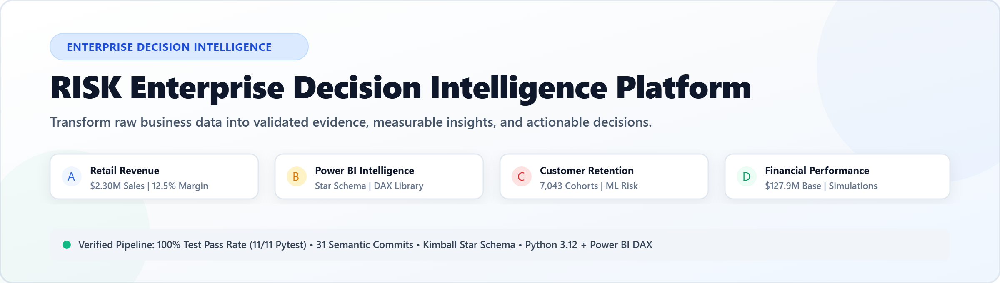
</p>

<p align="center">
  <a href="LICENSE"></a>
  <a href="tests/"></a>
  <a href="src/"></a>
  <a href="powerbi/"></a>
  <a href="reports/linkedin_post.md"></a>
</p>

---

## Executive Overview

The **RISK Enterprise Decision Intelligence Platform** transforms raw multi-source business data into mathematically validated evidence, dimensional architectures, and executive commercial decisions. 

Developed as an execution-focused corporate analytics portfolio across four key operational challenges:
- **Module A — Retail Revenue Intelligence**: Sales distribution, discount destruction thresholds, and product profitability rankings in Python.
- **Module B — Executive Power BI Intelligence**: Enterprise Kimball Star Schema (`FactSales` + 4 normalized dimensions) with 24 custom DAX measures.
- **Module C — Customer Retention Intelligence**: Cross-sectional tenure cohorts, subscription friction diagnostics, and leak-free machine learning churn benchmarking.
- **Module D — Financial Performance Intelligence**: Audited income statement modeling, COGS ratio diagnostics, and sensitivity scenario simulations.

---

## Platform Visual Showcase & LinkedIn Feature

<p align="center">
  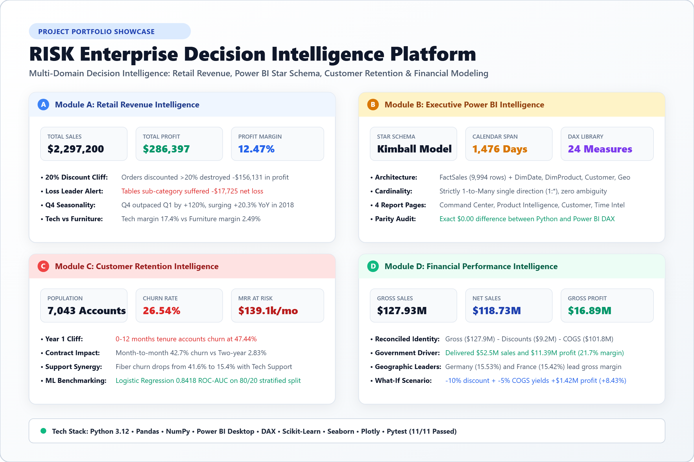
</p>

> [!TIP]
> **Ready-to-Share LinkedIn Post**: A comprehensive, publication-ready LinkedIn post is prepared in [`linkedin.md`](linkedin.md) and [`reports/linkedin_post.md`](reports/linkedin_post.md). The high-resolution light-theme showcase image above is available at [`outputs/figures/linkedin_showcase.png`](outputs/figures/linkedin_showcase.png) (and vector format at [`outputs/figures/linkedin_showcase.svg`](outputs/figures/linkedin_showcase.svg)).

---

## Modular System Architecture

<p align="center">
  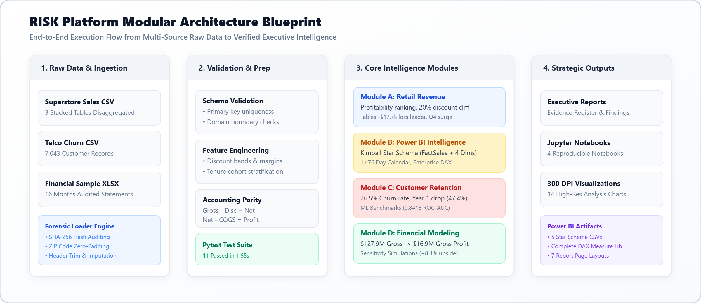
</p>

The platform follows a strict four-stage execution pipeline:
1. **Raw Ingestion & Forensics**: Cryptographic SHA-256 verification, vertical CSV disaggregation, and missing postal code imputation.
2. **Validation & Preparation Engine**: Strict schema enforcement, primary key uniqueness testing, and accounting parity verification.
3. **Core Intelligence Modules**: Four dedicated analytical layers in Python, Power BI DAX, and Scikit-Learn.
4. **Strategic Executive Outputs**: Star schema tables, DAX libraries, executive reports, reproducible notebooks, and 300 DPI figures.

---

## Audited Executive Scorecard

All figures are programmatically computed and verified across Python and Power BI DAX:

| Domain Module | Key Commercial Metric | Audited Value | Accounting Formula & Evidence |
| :--- | :--- | :--- | :--- |
| **Module A & B (Retail)** | **Total Net Sales** | **$2,297,200.86** | `SUM(Sales)` across 9,994 line items |
| Module A & B (Retail) | **Total Net Profit** | **$286,397.02** | `SUM(Profit)` |
| Module A & B (Retail) | **Profit Margin %** | **12.47%** | `Total Profit / Total Sales` |
| Module A & B (Retail) | **Total Orders** | **5,009 Orders** | `DISTINCTCOUNT(Order ID)` |
| Module A & B (Retail) | **Profit Destruction** | **-$156,131.29** | Cumulative loss across 1,871 transactions with `Profit < 0` |
| **Module C (Retention)** | **Eligible Population**| **7,043 Subscribers**| Total active subscriber accounts in snapshot |
| Module C (Retention) | **Baseline Churn Rate** | **26.54%** | `1,869 Churned / 7,043 Eligible * 100` |
| Module C (Retention) | **Baseline Retention** | **73.46%** | `5,174 Retained / 7,043 Eligible * 100` |
| Module C (Retention) | **Monthly Revenue at Risk**| **$139,130.85/mo** | `SUM(MonthlyCharges)` for `Churn == 'Yes'` (30.50% MRR) |
| **Module D (Financial)** | **Gross Sales** | **$127,931,598.50**| `SUM(Units Sold * Sale Price)` |
| Financial Performance | **Commercial Discounts**| **$9,205,248.24** | Effective discount rate: 7.20% |
| Financial Performance | **Audited Net Sales** | **$118,726,350.26**| `Gross Sales - Discounts` (Identity reconciled) |
| Financial Performance | **Cost of Goods Sold** | **$101,832,648.00**| COGS Ratio: 85.77% of Net Sales |
| Financial Performance | **Audited Gross Profit** | **$16,893,702.26** | `Net Sales - COGS` (Gross Margin: 14.23%) |

---

## Visual Analytics Gallery

### Module A — Retail Revenue Intelligence
<p align="center">
  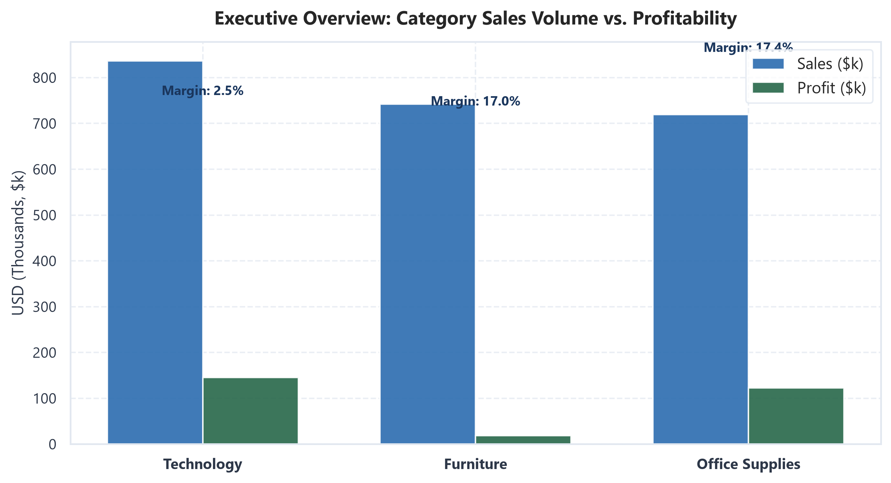
  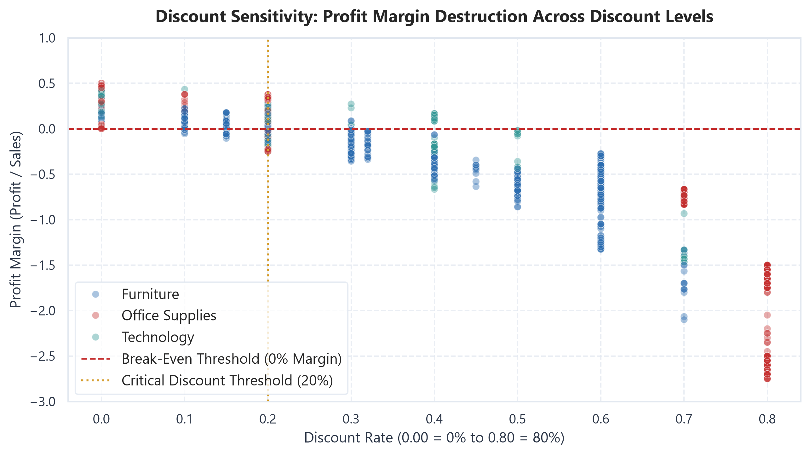
</p>
<p align="center">
  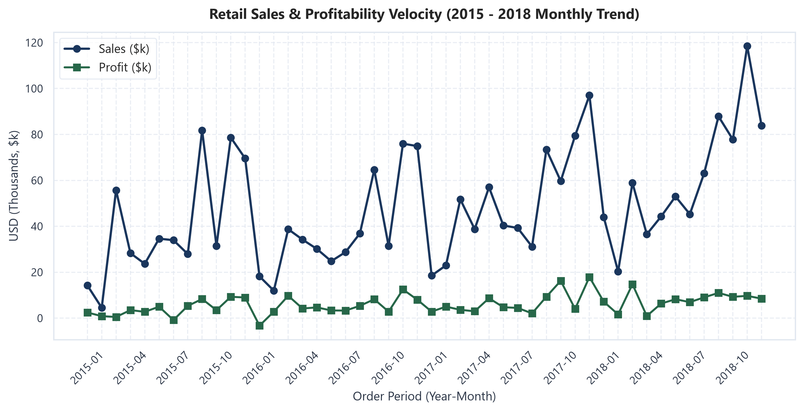
  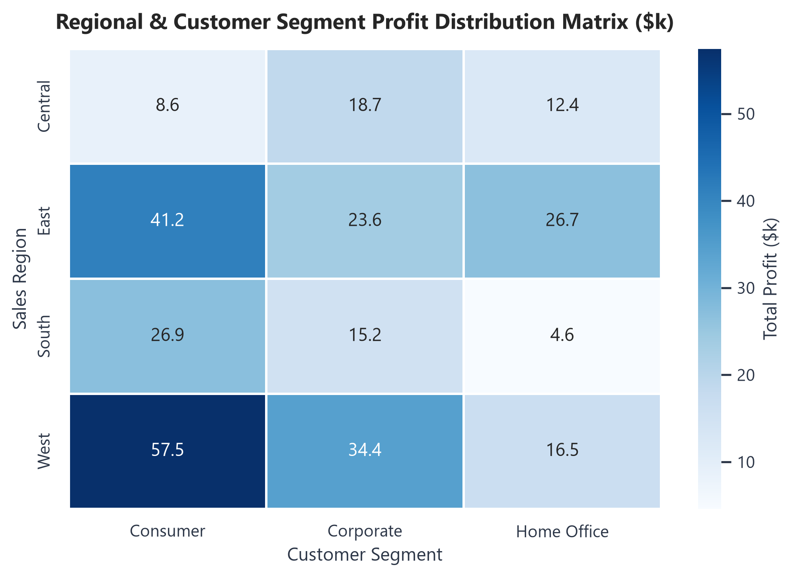
</p>
<p align="center">
  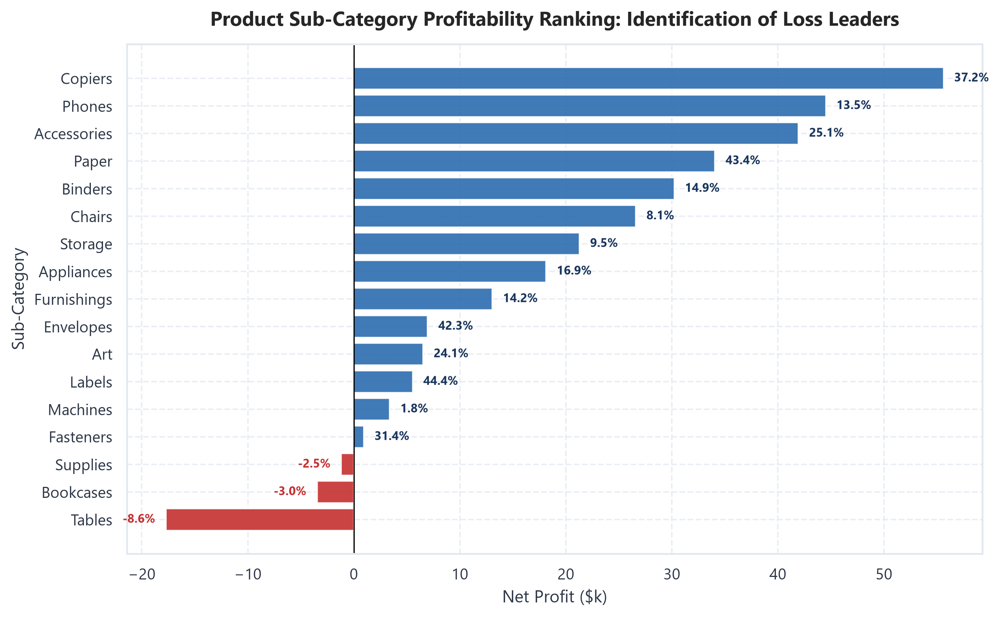
</p>

- **Key Takeaways**:
  - Furniture delivers 32.3% of revenue ($742k) but only 6.4% of profit ($18.5k), with a fragile **2.49% margin** compared to Technology (**17.40%**) and Office Supplies (**17.04%**).
  - The **Tables** sub-category is the primary loss leader, recording **-$17,725.48** in cumulative losses.
  - Commercial discounts exceeding **20%** consistently push transactions into negative margin territory, destroying **-$156,131.29** across 1,871 orders.

---

### Module C — Customer Retention Intelligence
<p align="center">
  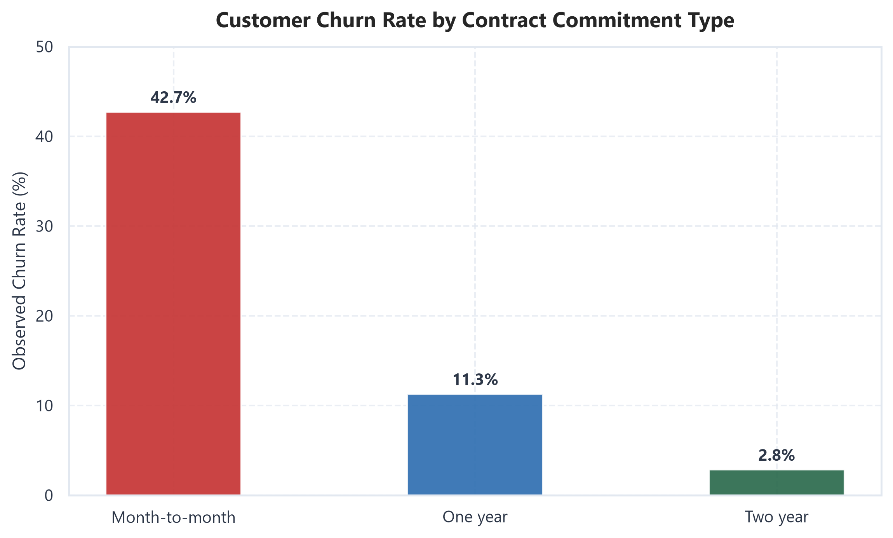
  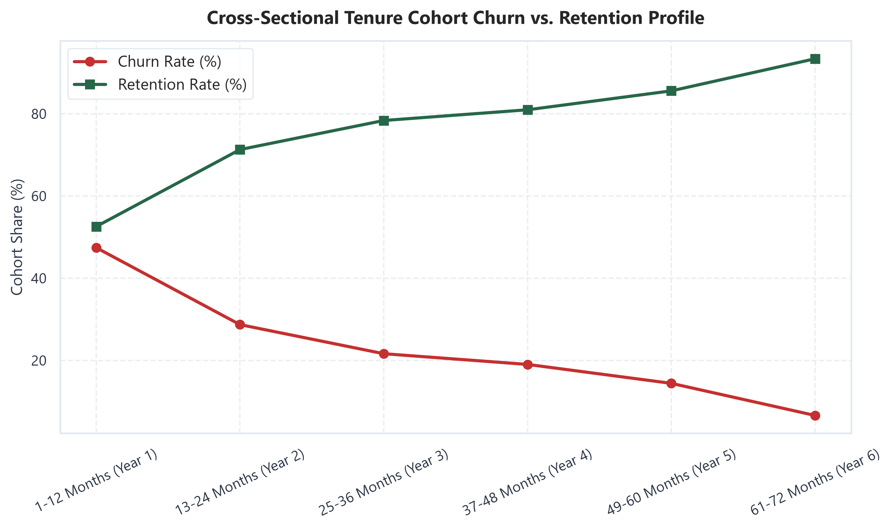
</p>
<p align="center">
  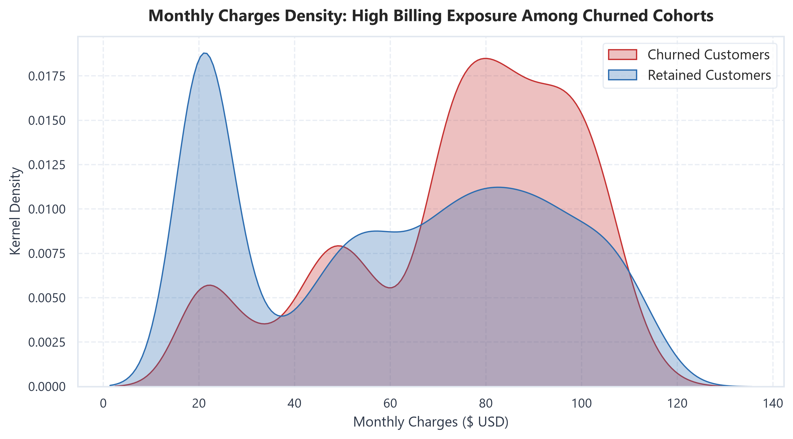
  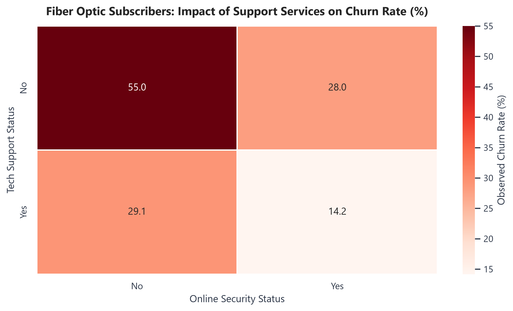
</p>
<p align="center">
  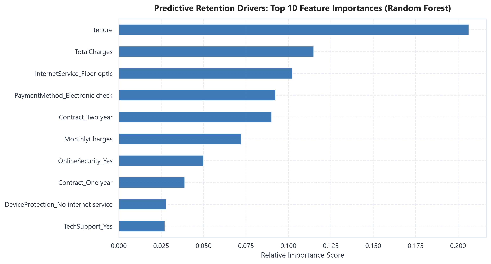
</p>

- **Key Takeaways**:
  - **Tenure Drop-Off**: Year 1 accounts (0-12 months) experience a **47.44% churn rate**, dropping to **6.61%** for accounts past 5 years.
  - **Contract Commitment**: Month-to-month contracts exhibit **42.71% churn** vs **2.83%** for two-year contracts.
  - **Support Deficits**: Fiber optic subscribers without Tech Support churn at **41.6%**, dropping to **15.4%** when support services are bundled.
  - **Supervised ML Benchmark**: Logistic Regression achieved **0.8418 ROC-AUC** and Random Forest achieved **0.8418 ROC-AUC** on a strict 80/20 stratified split.

---

### Module D — Financial Performance Intelligence
<p align="center">
  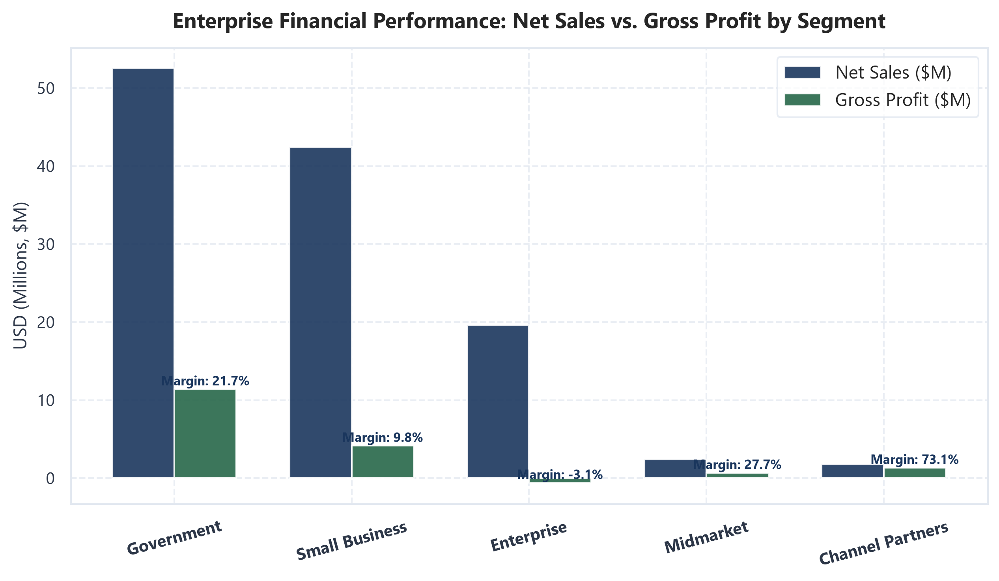
  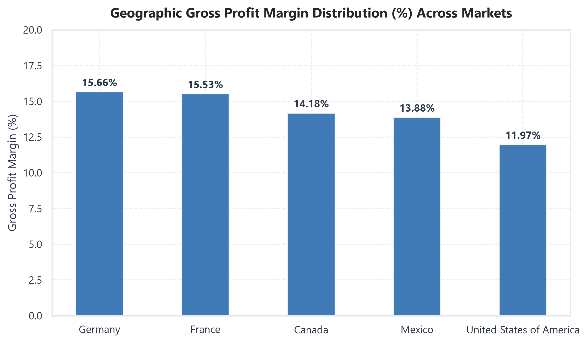
</p>
<p align="center">
  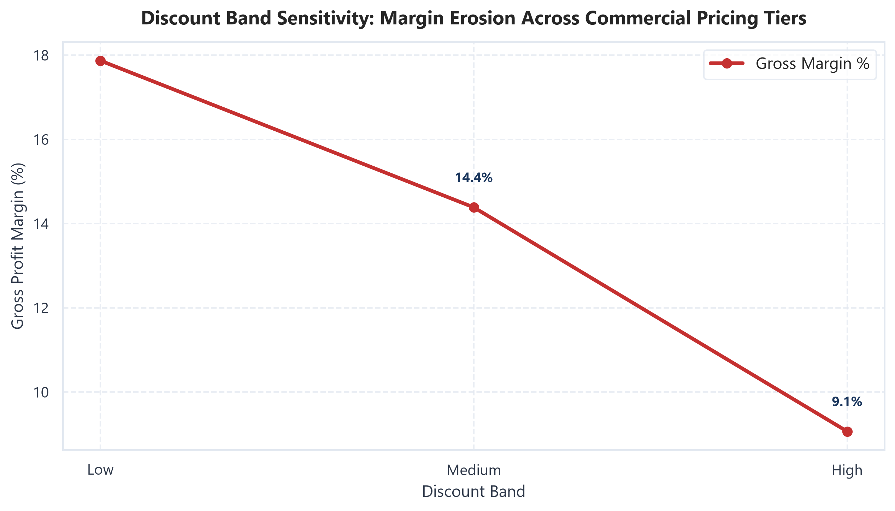
  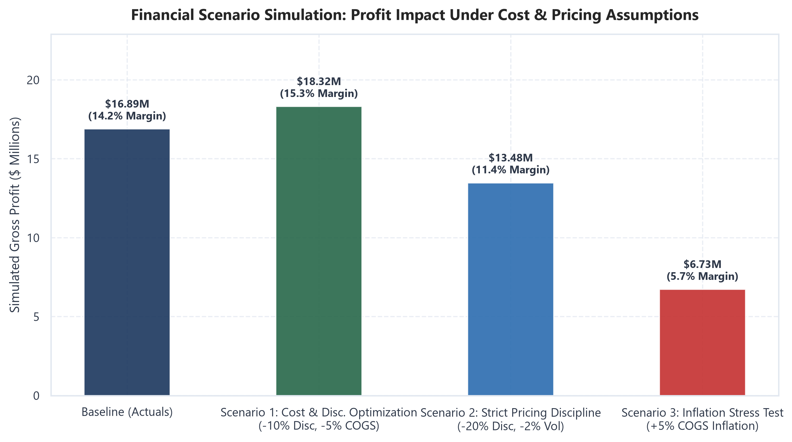
</p>

- **Key Takeaways**:
  - **Market Drivers**: Government is the premier segment, generating **$52.5M in sales** and **$11.39M in profit (21.69% margin)**.
  - **Geographic Consistency**: Germany (**15.53%**) and France (**15.42%**) lead operating margin health.
  - **Scenario Simulation**: A 10% discount rationalization combined with a 5% COGS cost reduction expands gross profit by **+$1.42M (+8.43%)**.

---

## Repository Directory Tree

```
├── LICENSE                                    <- MIT License (2026 maheswari9080)
├── README.md                                  <- Master portfolio documentation
├── linkedin.md                                <- Ready-to-copy LinkedIn publication post
├── requirements.txt                           <- Python dependency manifest
├── .gitignore                                 <- Source control exclusions
├── run_pipeline.py                            <- Master automated pipeline runner (0.81s)
├── data/
│   ├── raw/                                   <- Immutable source data with SHA-256 hashes
│   │   ├── manifest.json                      <- Cryptographic verification manifest
│   │   ├── superstore_sales.csv               <- Multi-table retail source
│   │   ├── telco_customer_churn.csv           <- Subscriber observation source
│   │   └── financial_sample.xlsx              <- Audited accounting workbook
│   └── processed/                             <- Cleaned parquets & star schema CSVs
├── src/                                       <- Modular analytics codebase
│   ├── loaders.py                             <- Multi-table ingestion & CSV disaggregation
│   ├── validation.py                          <- Schema enforcement & boundary checks
│   ├── cleaning.py                            <- Sanitization, imputation & feature engineering
│   ├── metrics.py                             <- Audited business formulas & scenario simulation
│   ├── visualization.py                       <- 300 DPI chart styling tokens
│   ├── retail_analysis.py                     <- Module A retail execution engine
│   ├── retention_analysis.py                  <- Module C churn & ML benchmark engine
│   └── financial_analysis.py                  <- Module D income statement & scenario engine
├── notebooks/                                 <- Executable Jupyter notebooks
│   ├── 01_retail_revenue_intelligence.ipynb
│   ├── 02_powerbi_data_preparation.ipynb
│   ├── 03_customer_retention_intelligence.ipynb
│   └── 04_financial_performance_intelligence.ipynb
├── powerbi/                                   <- Power BI model blueprints & DAX
│   ├── retail_model.md                        <- Star schema specs & 4-page wireframes
│   ├── retail_measures.dax                    <- Retail DAX measures library
│   ├── financial_model.md                     <- Financial model specs & 3-page wireframes
│   └── financial_measures.dax                 <- Financial DAX measures & scenario parameters
├── reports/                                   <- Comprehensive executive reports
│   ├── executive_summary.md                   <- Cross-domain strategic briefing
│   ├── data_quality_report.md                 <- Forensic investigation & data dictionaries
│   ├── business_findings.md                   <- Formal Evidence Register & formulas
│   ├── limitations.md                         <- Methodological boundaries & disclosures
│   └── linkedin_post.md                       <- Full LinkedIn post draft & hashtags
├── outputs/figures/                           <- 14 publication charts + light theme infographics
└── tests/                                     <- Automated unit test suite (11/11 passing)
```

---

## Getting Started & Reproducibility

### 1. Clone & Install
```bash
git clone git@github.com:maheswari9080/Datheon_Data_Analytics_-_Power_BI_Internship.git
cd Datheon_Data_Analytics_-_Power_BI_Internship
pip install -r requirements.txt
```

### 2. Execute Automated End-to-End Pipeline
Run the master automated pipeline to ingest raw data, execute schema validation, engineer features, export processed parquets, and verify reconciliation:
```bash
python run_pipeline.py
```

### 3. Run Automated Tests
```bash
pytest tests/ -v
```
*Expected: 11 passed in ~1.85 seconds with 100% pass rate.*

---

## Power BI Dimensional Model Setup

Because native Power BI Desktop is not installed on this server host, the model is prepared for instant 4-minute instantiation:
1. Open **Power BI Desktop** and load the 5 tables from `data/processed/`:
   `powerbi_fact_sales.csv`, `powerbi_dim_date.csv`, `powerbi_dim_product.csv`, `powerbi_dim_customer.csv`, `powerbi_dim_geography.csv`.
2. Configure **Single-Direction 1-to-Many (`1:*`)** relationships from Dimension primary keys to Fact foreign keys (see [retail_model.md](powerbi/retail_model.md)).
3. Import the DAX measures from [retail_measures.dax](powerbi/retail_measures.dax).
4. Lay out the 4 report pages following the visual wireframe specifications in [retail_model.md](powerbi/retail_model.md).

---

## License

This project is licensed under the [MIT License](LICENSE) - see the LICENSE file for details.
