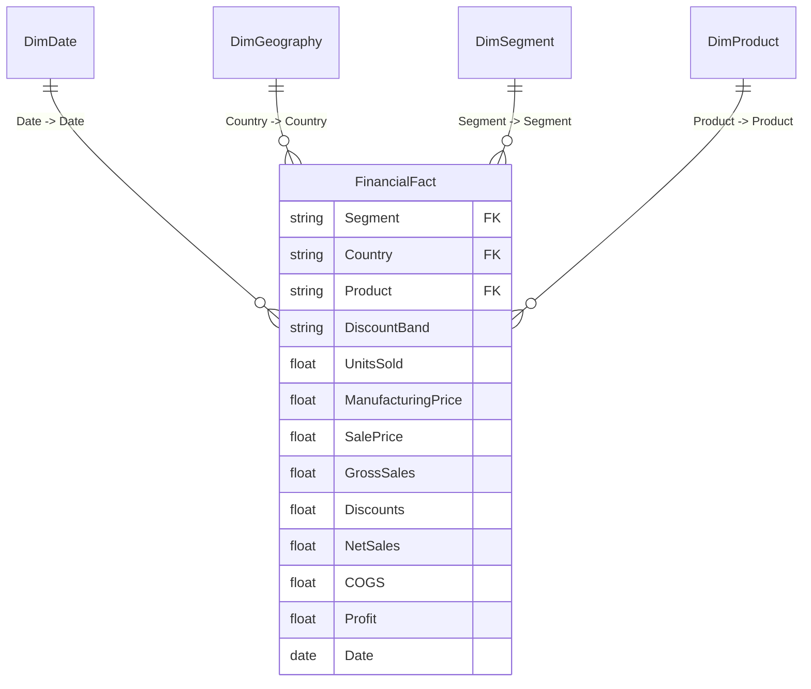

# Financial Performance Power BI Architecture & Implementation Guide
**Module**: Module D — Financial Performance Intelligence  
**Platform**: RISK Enterprise Decision Intelligence Platform  
**Solutions Architect**: Financial Intelligence Architect & Modeler  
**Accounting Standard**: GAAP Consistency & Source Reconciliation  

---

## 1. Accounting Model & Field Lineage

The Financial Sample dataset records commercial performance across 16 monthly reporting periods (September 2013 through December 2014) across 5 countries and 5 market segments.

### 1.1 Source Field Lineage & Accounting Definitions
- **Units Sold**: Volume of physical units delivered to clients.
- **Manufacturing Price**: Standardized unit production cost ($3 to $260/unit).
- **Sale Price**: Standardized gross list price per unit ($7 to $350/unit).
- **Gross Sales**: Exact product of `Units Sold * Sale Price`.
- **Discounts**: Total commercial price concessions granted based on Discount Band.
- **Sales (Net Sales)**: Audited net revenue after discounts: `Gross Sales - Discounts`.
- **COGS**: Cost of Goods Sold: `Units Sold * Manufacturing Price`.
- **Profit**: Audited Gross Profit before SG&A, tax, and financing: `Net Sales - COGS`.



---

## 2. Power Query M Script Recipe (Financial Model)

```powerquery
let
    Source = Excel.Workbook(File.Contents("data/raw/financial_sample.xlsx"), null, true),
    Sheet1_Sheet = Source{[Item="Sheet1",Kind="Sheet"]}[Data],
    #"Promoted Headers" = Table.PromoteHeaders(Sheet1_Sheet, [PromoteAllScalars=true]),
    #"Trimmed Headers" = Table.TransformColumnNames(#"Promoted Headers", Text.Trim),
    #"Changed Type" = Table.TransformColumnTypes(#"Trimmed Headers",{
        {"Segment", type text},
        {"Country", type text},
        {"Product", type text},
        {"Discount Band", type text},
        {"Units Sold", type number},
        {"Manufacturing Price", Int64.Type},
        {"Sale Price", Int64.Type},
        {"Gross Sales", type number},
        {"Discounts", type number},
        {"Sales", type number},
        {"COGS", type number},
        {"Profit", type number},
        {"Date", type date},
        {"Month Number", Int64.Type},
        {"Month Name", type text},
        {"Year", Int64.Type}
    }),
    #"Renamed Sales To Net Sales" = Table.RenameColumns(#"Changed Type",{{"Sales", "Net Sales"}})
in
    #"Renamed Sales To Net Sales"
```

---

## 3. Three Financial Dashboard Pages Architecture

### Page 1 — Financial Overview
- **Objective**: Audited financial statement overview of revenue, costs, and gross margins.
- **Top KPI Cards**:
  - `[Gross Sales]`: $127,931,598.50
  - `[Total Discounts]`: $9,205,248.24 (Effective Discount Rate: 7.20%)
  - `[Net Sales]`: $118,726,350.26
  - `[Total COGS]`: $101,832,648.00 (COGS Ratio: 85.77%)
  - `[Total Profit]`: $16,893,702.26 (Gross Margin: 14.23%)
- **Visuals**:
  - **Segment Revenue & Profit Contribution**: Clustered bar chart showing Government ($52.5M sales, $11.4M profit) and Small Business ($42.4M sales, $4.1M profit) as primary volume drivers.
  - **Geographic Margin Map**: Color-coded geographic distribution showing Germany (15.53% margin) and France (15.42% margin) leading profitability.
  - **Monthly Financial Velocity**: Area chart tracking Net Sales vs. COGS over 16 months.

### Page 2 — Cost & Margin Diagnostics
- **Objective**: Diagnostic inspection of cost inflation, discount leakage, and product margin health.
- **Visuals**:
  - **Waterfall Bridge**: Reconciliation from Gross Sales ($127.93M) -> Discounts (-$9.21M) -> Net Sales ($118.73M) -> COGS (-$101.83M) -> Gross Profit ($16.89M).
  - **COGS Ratio Distribution**: Breakdown of unit cost proportions across products (Paseo, VTT, Carretera, Amarilla, Velo, Montana).
  - **Discount Band Sensitivity Grid**: Comparison of Gross Margin across Discount Bands (None: 17.5%, Low: 16.8%, Medium: 14.8%, High: 10.9%).
  - **Enterprise Segment Margin Alert**: Highlights the Enterprise segment having the highest COGS ratio (87.2%) and lowest gross margin (12.8%).

### Page 3 — Scenario Intelligence & Stress Testing
- **Objective**: Interactive simulation of pricing discipline, cost containment, and supply chain inflation.
- **Parameters (What-If Slicers)**:
  - `[Discount Reduction %]`: Range 0% to 30% (step 5%).
  - `[COGS Reduction %]`: Range -10% to +10% (step 1%).
  - `[Volume Elasticity %]`: Range -10% to +5% (step 1%).
- **Visuals**:
  - **Baseline vs. Simulated Profit KPI Card**: Displays delta in dollars and margin points.
  - **Scenario Comparison Matrix**: Bar chart evaluating Baseline vs. Cost Optimization vs. Pricing Discipline vs. Inflation Stress Test.
  - **Disclosed Assumptions Banner**: Explicit statement that scenarios represent mathematical simulations rather than guaranteed projections.
